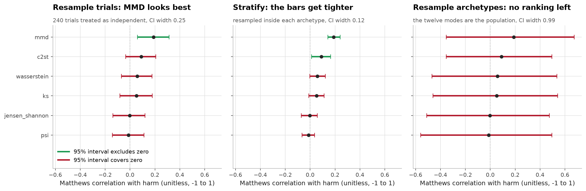
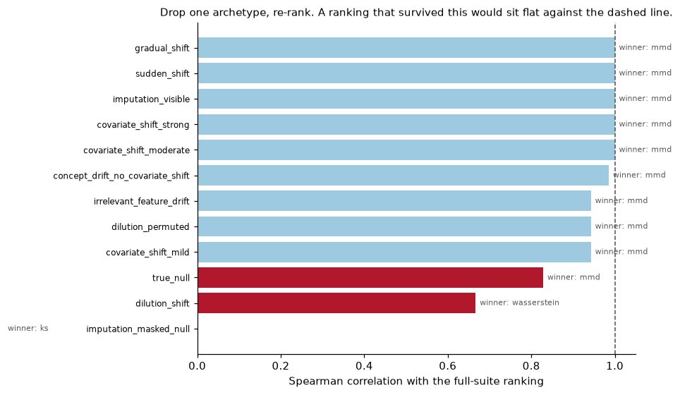
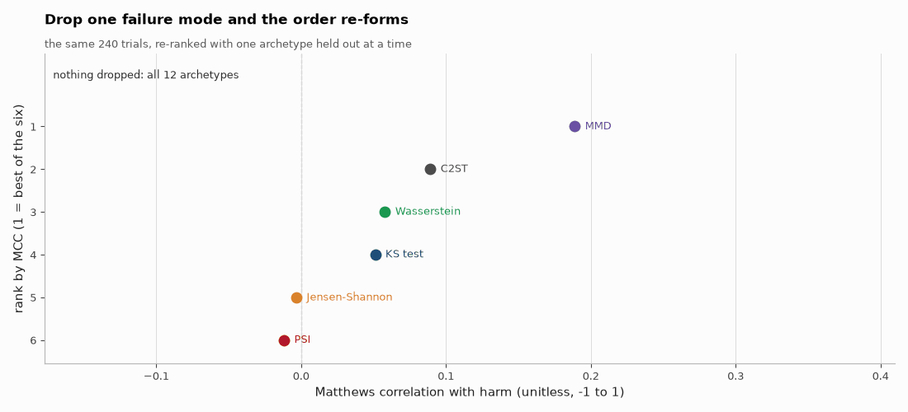
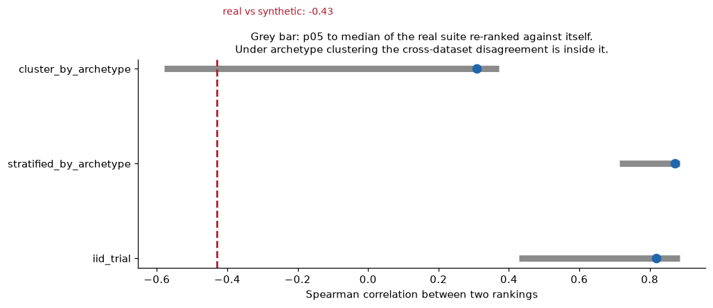
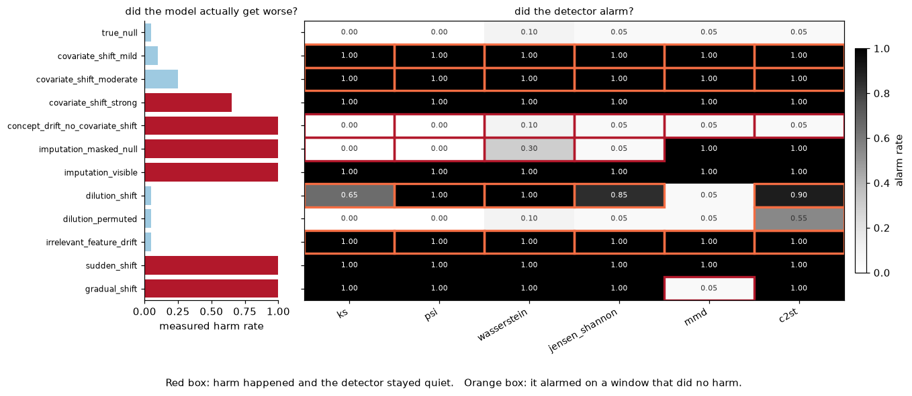
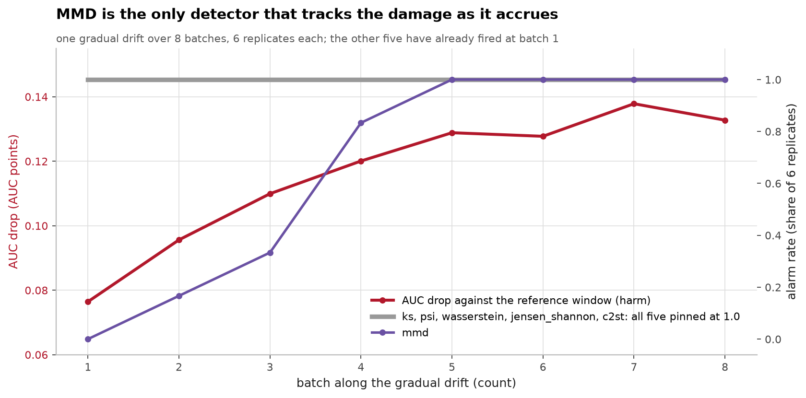
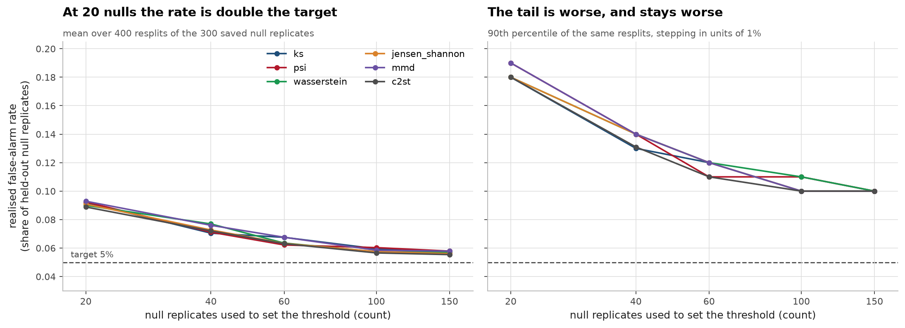

# DriftHarm

Do drift detectors tell you the model got worse?
I built a benchmark where the harm is actually measured, and found that the
detector ranking it gives isn't stable enough to report.

[](https://github.com/aghasalim/drift-harm/actions/workflows/ci.yml)
[](LICENSE)
[](https://doi.org/10.5281/zenodo.23003618)

Here's how it works. I apply twelve failure archetypes to windows drawn from a
held-out pool. A model that hasn't seen either window scores both. The harm label
is the drop in its AUC, compared with a null of window pairs where I changed
nothing. I calibrate six detectors against that same null at a shared 5% false-alarm
target, so none of them gets a tighter threshold than the others. Then I
cross-tabulate alarms against harm and score them with Matthews correlation.

Everything quoted here comes from a file in [`reports/`](reports/), and the long
version of each section is in [notes/METHODS.md](notes/METHODS.md). The code in
[`verify/`](verify/) recomputes every number from the trial level data on its own,
and CI fails if any of them disagree.

## The headline result

If you resample trials, MMD looks like the winner (MCC 0.189, 95% CI
[0.061, 0.315]). But the twelve failure modes are really what I care about, so the
right thing is to resample archetypes. When I do that, the mean interval width goes
from 0.25 to 0.99. Every interval covers zero, and the order tells you nothing.



There are 240 trials (12 archetypes × 20 replicates) on 20,000-row windows, and
the harm base rate is 51.7%. MCC, precision and recall are all measured against
harm, not against whether the distribution moved.

| detector | MCC | 95% CI, trials resampled | 95% CI, **archetypes resampled** | P(MCC > 0) | P(best of six) | harm-precision | harm-recall | specificity |
| --- | --- | --- | --- | --- | --- | --- | --- | --- |
| MMD | 0.189 | [0.061, 0.315] | [−0.353, 0.674] | 0.76 | 0.57 | 0.593 | 0.694 | 0.491 |
| C2ST | 0.089 | [−0.035, 0.207] | [−0.353, 0.495] | 0.66 | 0.18 | 0.539 | 0.831 | 0.241 |
| Wasserstein | 0.058 | [−0.069, 0.176] | [−0.468, 0.535] | 0.59 | 0.15 | 0.535 | 0.742 | 0.310 |
| KS | 0.051 | [−0.081, 0.179] | [−0.460, 0.542] | 0.59 | 0.11 | 0.536 | 0.661 | 0.388 |
| Jensen-Shannon | −0.003 | [−0.137, 0.121] | [−0.511, 0.476] | 0.51 | 0.00 | 0.516 | 0.669 | 0.328 |
| PSI | −0.012 | [−0.141, 0.112] | [−0.559, 0.496] | 0.50 | 0.00 | 0.512 | 0.661 | 0.328 |

Source: [`reports/real_ranking.csv`](reports/real_ranking.csv),
[`reports/real_rank_stability.csv`](reports/real_rank_stability.csv). Both
intervals are 2,000-draw percentile bootstraps.

The fourth column is the one to look at. The narrow interval treats the
240 trials as if they were 240 independent facts. They aren't. In 53 of the
72 (detector × archetype) cells, the alarm rate is exactly 0.00 or 1.00.
Harm-precision goes from 0.512 to 0.593, and the base rate is 0.517. So when a
detector fires, my belief that the model is damaged moves by somewhere between −0.5
and +7.6 percentage points. That's the main result. I go through it properly in
[notes/METHODS.md](notes/METHODS.md#21-the-detector-ranking-is-not-stable).



The bootstrap isn't the only sign of this. If I drop one archetype and re-rank,
the order moves about as much as it does under resampling, and the winner changes
a few times. Removing `imputation_masked_null` gives Spearman −0.46 against the
full-suite order, and KS becomes the winner.



*Each frame leaves out one of the twelve archetypes and re-ranks the same 240
trials. The detectors and harm labels stay the same, so any change in the order
comes from which archetype was left out.*

## Real and synthetic disagree no more than one dataset disagrees with itself

I ran the same code on a 60-dimensional correlated-Gaussian control, and the order
changed. MMD went 1st → 5th and PSI went 6th → 3rd, with Spearman −0.43. At first
that looks like a difference between datasets. It isn't. With archetype clustering,
resampling a dataset against itself gives a rank correlation at or below −0.43
about one time in seven (0.146 on real, 0.148 on synthetic).



There are two real mechanical differences under it, and both come from the same two
archetypes. The more interesting one is about missing values. Whether a drop-NaN
detector misses a feed outage depends on how much was already missing in the
reference table, not on the detector. The masked-null footprint is the same size on
both datasets. Still, KS alarms 0/20 on real and 20/20 on synthetic. That's because
19 of the 60 monitored real columns are above 80% NaN, and they set the null floor
themselves. The derivation and the footprint and null-floor tables are in
[notes/METHODS.md](notes/METHODS.md#222-what-is-genuinely-different-and-it-is-those-same-two-archetypes).

## Where the errors come from



Harm and alarms agree on the easy archetypes. On the harder ones they don't.
`concept_drift_no_covariate_shift` causes harm every time, with a mean AUC drop of
0.337. None of the six detectors notice, because I built it so the covariates don't
move. `irrelevant_feature_drift` does no harm, yet all six fire on 20/20 replicates.
It's the biggest single source of false alarms here, and you could avoid it by not
monitoring columns the model doesn't use. `imputation_masked_null` causes harm every
time, and only MMD and C2ST catch it. When I point the monitor at the post-imputation
table, KS and PSI go from 0/20 to 20/20. So switching the table the monitor reads
got me more recall than switching the detector did. I'd also labelled covariate
shift as harmless. Its three strengths gave harm rates of 0.10, 0.25 and 0.65. The
per-archetype table is in
[notes/METHODS.md](notes/METHODS.md#23-where-the-errors-actually-come-from).



With a gradual drift, five of the six detectors are already saturated at batch 1,
before most of the harm has happened. So their alarm tells you nothing about timing.
MMD is the one that rises with the damage. It's also the slowest. It gets 0/6
alarms at batch 1 and 6/6 only at batch 5, and it misses 19/20 gradual trials in
the main run.

## Instrument findings

I found four problems with my own measuring setup, and I've left them in. Each
one is covered under
[instrument findings](notes/METHODS.md#3-instrument-findings).

The harm label can't see damage to a segment, and the ranking depends on it.
Both dilution archetypes only damage the top 3% of rows by predicted risk, so the
aggregate rule calls them harmless. When I re-score with
`harm = aggregate OR segment`, MMD drops from first to last, 0.189 to −0.216,
and C2ST moves from second to first.

Threshold calibration needed more null replicates than I first used. With 20
null replicates, every detector overshoots the 5% target by about double. I now
use 300, with 150 for calibration and 150 held out.

The "irrelevant" features in the synthetic bundle aren't really irrelevant.
The fitted LightGBM puts 3.6% of its split gain on the zero-weight columns. So the
harm rate for that archetype on synthetic is 0.35, not the ~0.05 I meant it to be.
The real bundle doesn't have this problem.

I score with MCC instead of F1. C2ST has the best harm-F1 on real data, 0.654. But
it gets its 0.831 recall with 88 false positives and a specificity of 0.241. MCC
looks at the whole table, so I use it as the scoring column.

Realised false-alarm rate against calibration sample size:



## Limitations

I used one real dataset (IEEE-CIS, tabular fraud, 3.7% positive rate) and one
synthetic generator. I haven't checked anything on text, images or time series.
The twelve archetypes are my own list and far from complete. That's where nearly
all the uncertainty comes from. More replicates won't fix it, but more archetypes
might. I didn't sweep detector hyperparameters. Aggregation over columns is always
`max`, the window size is fixed at 20,000 rows, and harm is a binary AUC drop. I
didn't measure calibration, precision at an operating threshold, or money. The
full list is under [limitations](notes/METHODS.md#4-limitations).

## Related work, and what is actually new here

The main observation here isn't new, so I want to be clear about what is.

**[aghasalim/mlops-fraud-pipeline](https://github.com/aghasalim/mlops-fraud-pipeline)**
is my earlier project, and it already showed that drift alerts don't track
performance loss. It monitored KS, PSI and missing-rate over eight windows of
IEEE-CIS traffic. Prediction PSI correlated −0.709 with AUC loss, and prediction
stability looked best right where the model was worst. With n = 8 I said that was
only suggestive. It also found the dropped-NaN blind spot, and that input monitors
can't see label shift.

So I started from "drift ≠ harm" here. I didn't discover it. The five things
DriftHarm adds are listed under
[related work](notes/METHODS.md#5-related-work).

Prior work I checked:

- NannyML has written about the same idea. Drift methods give false alarms
  because not all drift hurts performance, so they argue performance estimation
  should be the main signal instead. Their
  ["Don't let yourself be fooled by data drift"](https://www.nannyml.com/blog/when-data-drift-does-not-affect-performance-machine-learning-models)
  post shows it on one dataset (Tetouan City power consumption), comparing
  univariate drift with their DLE performance estimator. It's a demo. It doesn't
  rank detectors or report false-alarm or precision/recall numbers for drift
  alerts. The argument is theirs. What I measure here is different.
- **Singh, "When Drift Detectors cry Wolf: False Alarm Rates in continuous ML
  Monitoring"**, [arXiv:2607.17336](https://arxiv.org/abs/2607.17336) (19 Jul
  2026, ICLR 2026 CAO workshop). It measures false positives for PSI, KS, MMD,
  LSDD and adversarial validation under continuous monitoring. It finds PSI is very
  sensitive to batch size above/below roughly 200 samples. It's the closest
  published work to finding 2 above. It measures false alarms without harm labels,
  and that's the gap I'm trying to fill from the other side.
- **Giobergia, Pastor, de Alfaro & Baralis, "A Synthetic Benchmark to Explore
  Limitations of Localized Drift Detections"**,
  [arXiv:2408.14687](https://arxiv.org/abs/2408.14687) (26 Aug 2024). They put
  drift in a random subgroup and show that common detectors fail when the drift
  stays in a small part of the population. That's direct prior art for my two
  dilution archetypes. The only thing I add there is measuring the segment-level
  harm, which is how I found instrument finding 1.
- **Cerqueira, Gomes, Heyden, Pfahringer & Bifet, "A Framework for Evaluating and
  Benchmarking Concept Drift Detection Methods"**,
  [arXiv:2606.07789](https://arxiv.org/abs/2606.07789) (5 Jun 2026). They
  benchmark 14 concept-drift detection methods over 7 real datasets, with
  timing-aware metrics and Monte-Carlo drift injection. On detection quality it's
  bigger and more careful than this repo. It scores detection, though, not harm
  further down the line.

If you want the more reliable version of the argument, read those.

## Reproducing

```bash
make setup                # venv + editable install
make test                 # 45 tests, ~7s, no dataset needed
make bench-synthetic      # synthetic run end to end (~24 min on an M-series laptop)
make analysis             # regenerate every table above from reports/*.csv (free)
```

The real run needs the IEEE-CIS `train_transaction.csv` and `train_identity.csv`
from the [Kaggle competition](https://www.kaggle.com/c/ieee-fraud-detection/data)
in `~/ieee-fraud-ml/data/raw/`, then `make bench-real`. It trains a fresh
LightGBM on the earliest 40% of the stream by `TransactionDT` and holds out the
rest. Held-out AUC is 0.891 on all 431 features. Through the 60 monitored columns
the benchmark drives, it's 0.857. CI only runs the tests on the synthetic bundle,
so it never needs the 700 MB download. There's more under
[reproducibility](notes/METHODS.md#6-reproducibility).

## Map of the repository

```
src/driftharm/     six detectors, the twelve archetypes, harm labels, null
                   calibration, the suite runner, metrics, and both bundles
experiments/       01 prepare, 02 benchmark, 03 tables, 04 calibration sweep,
                   05 harm-label sensitivity, 06 rank stability, 07 figures
reports/           every CSV/JSON quoted above, tracked on purpose
reports/figures/   the figures, redrawn from those CSVs by `make figures`
tests/             45 tests on the generators and metrics
notes/METHODS.md   the full write-up this page summarises
```

Notes on each file, and what the tests check, are under
[repository layout](notes/METHODS.md#7-repository-layout).

MIT licensed.

## The four sources this is built on

- **Rabanser, Günnemann, Lipton. Failing Loudly: An Empirical Study of Methods for Detecting Dataset Shift. NeurIPS 2019.** [arXiv:1810.11953](https://arxiv.org/abs/1810.11953) the detector comparison protocol this follows.
- **Gretton, Borgwardt, Rasch, Schölkopf, Smola. A Kernel Two-Sample Test. JMLR 13, 2012.** the MMD detector.
- **Ke, Meng, Finley et al. LightGBM: A Highly Efficient Gradient Boosting Decision Tree. NeurIPS 2017.** the model whose degradation is measured.
